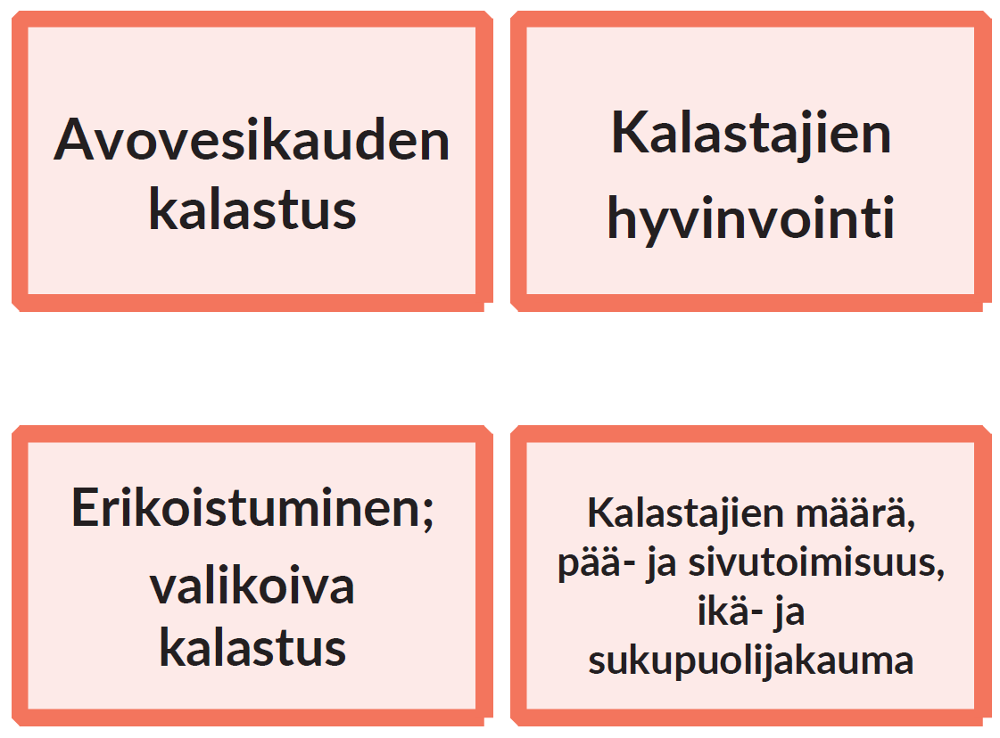

# Commercial Fishing on Northern Lakes

This adaptation was made to better understand the operational environment of commercial fishers, operating on lakes in northern areas. 

  
   
  <small>Example cards for the adaptation in Finish.</small>

## About this adaptation

We were interested to discuss the changes in the operational environment and coping and adaptation of fishers and the livelihood. Tool has been developed keeping commercial lake fishing in northern Finland in mind, also in artificial lake settings, but it will work also with recreational fishing, in coastal/maritime environments, and with fisher communities elsewhere, with little adjustments. 

[Read the full adaptation documentation]({{ site.baseurl }}/applications/freshwater-fishing/adaptation/){: .btn .btn-primary }

## Download the card set

| Language | Printable card set |
|---|---|
| Finish | [Download PDF](materials/Kalakortit_2026_six_per_page.pdf) |

## Workshops using this adaptation

| Workshop | Preview |
|---|---|
| **[WORKSHOP TITLE](workshops/WORKSHOP-SLUG/)**  SHORT DESCRIPTION OF THE WORKSHOP, ITS PURPOSE AND PARTICIPANTS. |  |